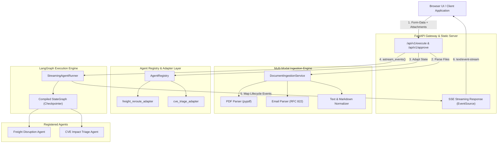

# ⚡ Agent Nexus

[](https://www.python.org/downloads/)
[](https://fastapi.tiangolo.com)
[](https://github.com/langchain-ai/langgraph)
[](https://docs.pydantic.dev/)
[](LICENSE)

**Agent Nexus** is an autonomous multi-agent gateway and real-time execution engine. It bridges LangGraph state machines to web clients through unified Server-Sent Events (SSE), handles multi-modal document ingestion (PDFs, RFC 822 emails, plain text), supports human-in-the-loop checkpoints, and includes a responsive, zero-build chat workbench.

---

## 🏛 Architecture Overview



---

## 💡 Why Live Graph Visualization Matters

In traditional enterprise automation, multi-agent AI execution is treated as a black box: an input enters, the user sees an ambiguous spinner for 30–60 seconds, and a monolithic result emerges. This causes substantial anxiety for operations managers, dispatchers, and security analysts who cannot observe intermediate reasoning steps or verify data sources.

**Agent Nexus fundamentally changes this experience:**
1. **Granular Node Lifecycle Visibility**: By streaming discrete `NODE_START` and `NODE_END` event chips directly from the graph lifecycle, operators see exactly what the agent is doing in real time (`inspect_manifest` &rarr; `detect_bottlenecks` &rarr; `reroute_freight`).
2. **Deterministic Human-in-the-Loop Interruption**: When execution hits financial or policy thresholds (e.g., container reroute costing &gt; $5,000), LangGraph pauses execution cleanly into an isolated thread checkpointer and emits `HUMAN_APPROVAL_REQUIRED`.
3. **Interactive Action Cards**: The operator receives an action card directly within the chat stream with full context, approving or rejecting the decision without restarting the workflow.

---

## 📋 Architecture Decision Record (ADR 001)

### Context & Problem Statement
The execution engine must stream token deltas, node progress updates, and checkpoint interruptions to web clients in real time while allowing human approval feedback. We evaluated **Server-Sent Events (SSE)** versus **WebSockets**.

### Decision
We selected **Server-Sent Events (SSE)** over WebSockets for client streaming.

### Rationale
* **HTTP/2 Multiplexing & Standard Infrastructure**: SSE runs over standard HTTP/2 streams (`text/event-stream`), avoiding WebSocket upgrade handshakes and firewall/proxy blocking in enterprise networks.
* **Native Browser Resiliency**: The browser `EventSource` API (and modern stream readers) provide automatic reconnection and message buffering natively.
* **Unidirectional Streaming Fit**: Agent workflows are primarily streaming unidirectional updates from graph to client. Resuming execution after human decisions is naturally modeled as a clean REST call (`POST /api/v1/approve`) that returns a new SSE stream from the checkpoint.
* **Lower Overhead**: Eliminates the stateful socket management overhead of WebSockets while maintaining sub-millisecond event dispatch latency.

---

## 🚀 Quickstart Guide

### Option 1: Local Development

#### Prerequisites
* Python 3.11+
* Git

```bash
# 1. Clone repository
git clone https://github.com/singhalkapil/agent-nexus.git
cd agent-nexus

# 2. Set up virtual environment
python3 -m venv .venv
source .venv/bin/activate

# 3. Install dependencies in editable mode
pip install -e ".[dev]"

# 4. Copy environment configuration
cp .env.example .env

# 5. Launch Gateway Server
uvicorn agent_nexus.api.main:app --host 0.0.0.0 --port 8000 --reload
```

Visit **`http://localhost:8000`** in your browser to access the interactive Workbench UI.

---

### Option 2: Docker Compose (Production Setup)

```bash
# 1. Build and run containerized gateway
docker compose up --build -d

# 2. View container logs
docker compose logs -f agent-nexus

# 3. Check health status
curl -f http://localhost:8000/health
```

The gateway is now running at `http://localhost:8000`.

---

## 🔌 How to Plug In a New Agent

Adding a new agent takes three clean steps:

### Step 1: Define Your Graph and Nodes
```python
from langgraph.graph import StateGraph, START, END
from langgraph.checkpoint.memory import MemorySaver


def analyze_sentiment(state: dict) -> dict:
    return {"sentiment": "positive", "score": 0.94}


def create_customer_agent_graph():
    builder = StateGraph(dict)
    builder.add_node("analyze_sentiment", analyze_sentiment)
    builder.add_edge(START, "analyze_sentiment")
    builder.add_edge("analyze_sentiment", END)
    return builder.compile(checkpointer=MemorySaver())
```

### Step 2: Write an Input Adapter
```python
def customer_agent_adapter(prompt: str, attachments: list) -> dict:
    return {
        "customer_query": prompt,
        "attached_files_count": len(attachments),
    }
```

### Step 3: Register in `src/agent_nexus/registry/catalog.py`
```python
from agent_nexus.schemas.protocol import AgentMetadata
from agent_nexus.registry.catalog import default_registry

support_metadata = AgentMetadata(
    agent_id="customer-support-agent",
    name="Customer Support Intelligence",
    description="Analyzes customer feedback and classifies sentiment.",
    input_types=["text/plain"],
    supported_files=[".txt"],
)

default_registry.register_agent(
    metadata=support_metadata,
    adapter_fn=customer_agent_adapter,
    graph_factory_fn=create_customer_agent_graph,
)
```

The agent is now immediately discoverable via `GET /api/v1/agents` and selectable in the Workbench UI!

---

## 🧪 Running Tests

Execute the comprehensive test suite with `pytest`:

```bash
pytest -v
```

### Test Suite Structure
* `tests/test_protocol.py`: Pydantic v2 immutability, literal validation, and JSON roundtrip serialization.
* `tests/test_ingestion_registry.py`: Document ingestion service (PDF text extraction, RFC 822 email parser, size limits) and agent registry adapters.
* `tests/test_streaming_engine.py`: LangGraph `astream_events` lifecycle mapping, token streaming, and checkpoint interrupts.
* `tests/test_api_endpoints.py`: End-to-end FastAPI HTTP endpoints (`/api/v1/execute`, `/api/v1/approve`, `/api/v1/agents`, and static UI mount).

---

## 📄 License

This project is licensed under the [MIT License](LICENSE).
